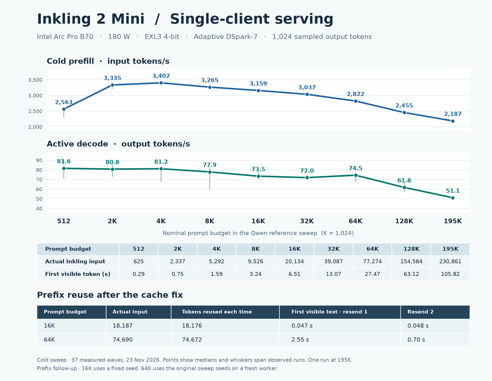

# Inkling 2 Mini on Intel Arc Pro B70

Run **Inkling 2 Mini on one 32 GB Intel Arc Pro B70** with a **262,144-token context window**, vision and tool calling. The repository provides the vLLM adapter, native Intel XPU kernels and launch scripts for an OpenAI-compatible server. The measured 180 W profile uses 4-bit EXL3 weights and adaptive DSpark speculative decoding.

## Current profile

| | Optimized configuration |
| --- | --- |
| Hardware | One Arc Pro B70, 32 GB. Standard card limit 180 W. |
| Model | 4-bit EXL3 experts, BF16 dense weights. [Pinned checkpoint](https://huggingface.co/grant-ai/Inkling-2-Mini-EXL3-4bpw/tree/c266f76b68429255e1d6ec151d0aa15f48f6abcc) |
| Runtime | vLLM 0.33.0 and PyTorch 2.15.0+xpu |
| Context and cache | 262,144 input and output tokens per request, shared FP8 KV pool, automatic prefix reuse |
| Serving | Up to four active sequences, 6,144-token prefill chunks, up to seven DSpark proposals per request and round |
| API | Chat, images, streamed tool calls and completions at `http://127.0.0.1:8093/v1`. Model ID `inkling2-mini-exl3-b70`. |

## Concurrent serving at 180 W

With all four clients decoding 4K code-review prompts, the B70 generated **122.3 tok/s with ordinary decode** and **106.3 tok/s with adaptive DSpark B7** in aggregate. With one active client, DSpark achieved **82.8 decode tok/s**. [Pure decode by concurrency, Qwen comparison and validation](benchmarks/2026-11-23/batching/README.md)

## Long-context performance at 180 W

One client reviewed frozen source files and generated 1,024 tokens per request. At **77,274 actual input tokens**, the median was **2,822 input tok/s** and **74.5 output tok/s**. The longest request in the sweep took **230,861 input tokens** and reached **51.1 output tok/s**. The chart gives the actual Inkling token count beneath each reference budget.



The earlier single-slot serving benchmark covers 20 scenarios and 124 requests, including concurrent clients. A separate capacity check filled the full window with 262,016 input and 128 output tokens. [Full serving results and Qwen comparison](benchmarks/2026-11-23/serving/README.md) · [Maximum-context check](benchmarks/2026-11-23/prefill-180w/README.md) · [Prefix-cache fix](benchmarks/2026-11-23/prefix-cache/README.md)

## Peak throughput at 230 W

With **8,192 uncached input tokens**, median engine prefill rose from **3,281 tok/s at 180 W** to **3,656 tok/s at 230 W** over 12 runs per limit. The fastest decode was **199.9 tok/s** expanding a synthetic zero matrix. Updating 64 API routes reached **166.7 tok/s**. [Peak chart](benchmarks/2026-11-23/serving/inkling-peak-throughput.png) · [Measurements, prompts and engine settings](benchmarks/2026-11-23/peak-throughput/README.md)

## Build and serve

Start with Linux, Docker and a working B70 render node. Follow the setup guide to prepare the builder and runtime images and download the pinned EXL3 weights. Power limits are set on the host. [Setup and checkpoint download](docs/SETUP.md)

From the repository root, build and check the kernels once, then launch the optimized profile with vision enabled.

```bash
bash scripts/check-sycl.sh
bash scripts/check-sycl.sh exl3
INKLING2_EXL3_TILE_ROWS=32 bash scripts/check-sycl.sh exl3 --tokens 256 512
INKLING2_EXL3_TILE_ROWS=32-64 bash scripts/check-sycl.sh exl3 --small-dpas --tokens 4 7 8 47 2047 2048 2129 6144
bash scripts/check-sycl.sh paged-fused
bash scripts/check-sycl.sh paged-batch
bash scripts/build-loop-control.sh

INKLING2_PREFILL_PROFILE=optimized INKLING2_VISION=1 INKLING2_VISION_FUSED_QKV=1 \
  bash scripts/serve-coding-agent.sh dspark
```

Once the server is ready, check it from a second terminal.

```bash
curl -fsS http://127.0.0.1:8093/health
curl -fsS http://127.0.0.1:8093/v1/models
```

The same launcher accepts `ordinary` for decoding without a drafter. A separate llama.cpp recipe runs the Unsloth GGUF checkpoint. [llama.cpp setup](docs/SETUP.md#llamacpp-and-dspark)

## Coding and vision results

| Workload | Result |
| --- | --- |
| Ten blind Pi coding repairs | Adaptive Inkling passed 7/10 and returned all seven before the deadline. [Tasks, grading and Qwen comparison](benchmarks/2026-11-22/quality/README.md) |
| Long-context Django repair | Both seeds passed from 240,518 initial tokens with Pi retaining 4,096 recent tokens during compaction. [Settings and test results](benchmarks/2026-11-22/quality/long-pi.md) |
| Screenshots and tools | A Pi browser session read a randomized screenshot. A separate image-and-text request retrieved its target at 240,006 input tokens. [Vision checks](benchmarks/2026-11-22/vision/README.md) |
| Three Vue apps built with Pi | Inkling passed 43/44 browser and build checks on first submission. Qwen passed 42/44. [Results and screenshots](benchmarks/2026-11-23/pi-browser-comparison/README.md) |

[Benchmark archive](benchmarks/) · [Kernel patches](patches/) · [Third-party notices](NOTICE.md)
