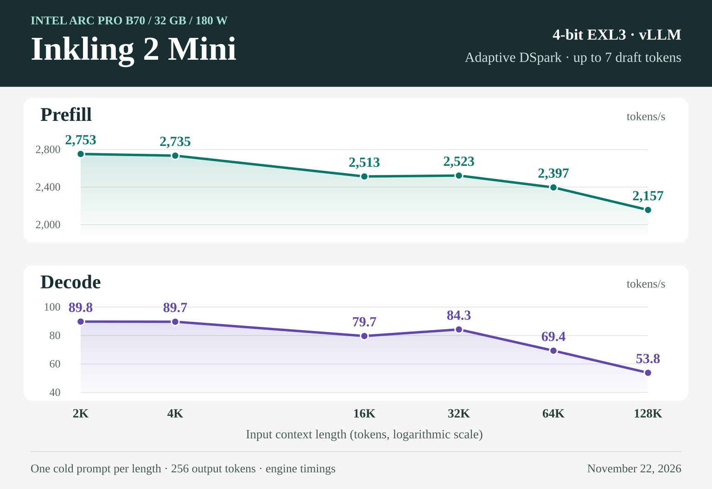

# Adaptive DSpark seven on a single Arc Pro B70

A synthetic, single-request context sweep on the 180 W card, using the EXL3 checkpoint, the optimized 6,144-token prefill chunk, FP8 global KV and a vision-capable text endpoint. The coding launcher at `b358d51` selected adaptive seven by default. Each request used a fresh cache salt and contained exactly the stated number of input tokens. The input was a frozen source archive with one review question. The engine generated 256 tokens at every length with temperature 1, top-p 0.95, top-k 20 and seed 42. We warmed the engine with 1,024 input tokens and 256 output tokens before collecting one sample per size.

| Input tokens | Engine prefill (tok/s) | Engine decode (tok/s) | Client decode (tok/s) | Client first text (s) |
| ---: | ---: | ---: | ---: | ---: |
| 2,000 | 2,752.7 | 89.83 | 90.71 | 0.76 |
| 4,000 | 2,734.9 | 89.72 | 90.63 | 1.49 |
| 16,000 | 2,513.4 | 79.68 | 81.18 | 6.43 |
| 32,000 | 2,523.0 | 84.30 | 86.17 | 12.76 |
| 64,000 | 2,396.6 | 69.36 | 70.69 | 26.79 |
| 128,000 | 2,156.9 | 53.81 | 54.76 | 59.46 |

Prefill divides the full input token count by the engine’s prefill timer. Decode divides the 255 tokens following the first by the engine’s decode timer. Client decode uses the interval from the first nonempty streamed text to stream completion. Each row verified zero cached input tokens, complete output, speculative rounds and a single completed request. DSpark acceptance can vary with the continuation. [Raw counters and token-ID hashes](adaptive-seven-context.jsonl)

To reproduce, start `INKLING2_PREFILL_PROFILE=optimized INKLING2_VISION=1 INKLING2_VISION_FUSED_QKV=1 bash scripts/serve-coding-agent.sh dspark`. With the server ready, run `python3 scripts/bench-adaptive-context.py long.txt results/context-sweep.jsonl` from the repository root. [Frozen source corpus](quality/replay/README.md)
