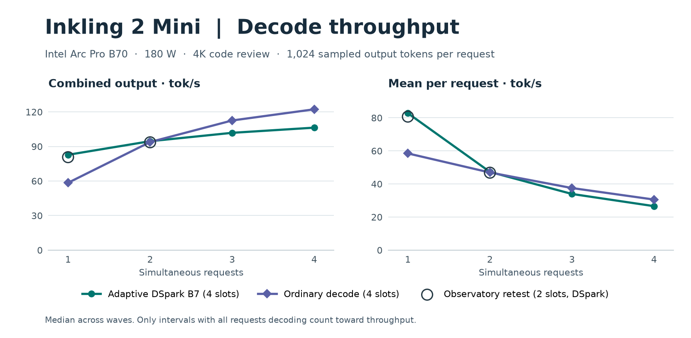

# Continuous batching on the Arc Pro B70

The vLLM V2 worker shares one EXL3 target and one set of DSpark weights across up to four active requests. Each request owns its convolution history, local attention ring and drafter KV state. The scheduler assigns a physical ring when it admits a request to the global KV page pool. An idle ring can supply a prefix hit when the block hashes, including the cache salt, match. Aborting a request releases its slot without publishing its uncommitted history. The worker sizes global draft KV from the admitted prompt length. A long cold prefill releases cached decode graphs. When idle draft histories would exceed the device budget, the worker preserves their exact KV tensors on the host and restores them on a matching resume.

During decode the native XMX attention kernel uses per-request query boundaries and page tables. A single target forward can verify different proposal widths in the same step. DSpark batches its projections and keeps proposal probabilities, sampling seeds and confidence cutoffs separate for each request. Chunked prefills can run alongside a decoding request. Full prefix-tail hits reuse their saved outputs.

## Pure decode at 180 W



Both modes below ran with four available slots. Rates are output tokens per second. Each speedup uses the single-request median for the same mode.

| Active requests | DSpark B7 total | Per request | Total vs. 1 | Ordinary total | Per request | Total vs. 1 |
| ---: | ---: | ---: | ---: | ---: | ---: | ---: |
| 1 | 82.8 | 82.8 | 1.00× | 58.5 | 58.5 | 1.00× |
| 2 | 94.6 | 47.3 | 1.14× | 93.9 | 46.9 | 1.61× |
| 3 | 101.8 | 33.9 | 1.23× | 112.6 | 37.5 | 1.93× |
| 4 | 106.3 | 26.6 | 1.28× | 122.3 | 30.6 | 2.09× |

On the deployed two-slot worker, the same DSpark replay reached **80.7 tok/s** for one request and **93.6 tok/s combined** for two (**46.8 tok/s per request**, 1.16× the single-request throughput). Open circles mark this retest.

For each wave, the common decode window begins after every stream has emitted text and ends by the earliest final text event. The report trims a monitor sample from each edge. It sums engine generation-token deltas and elapsed time across adjacent samples with all clients running, zero waiting requests, and no intervening prefill, completion or preemption. Dividing those tokens by those seconds gives aggregate pure decode. The per-client column is that rate divided by the number of active clients.

Both decode modes used identical R12 code-review prompts and sampling settings. The nominal 4K input contained 3,864–5,514 Inkling tokens. Each client generated 1,024 tokens. Thinking was disabled in this synthetic comparison. Medium thinking with a cumulative per-request budget is available in the coding profile. Each Inkling mode completed 42 requests across 18 waves. The table reports medians of five measured C1 waves and three waves each at C2, C3 and C4. The four warm-up waves are excluded. The ordinary 4K run preceded the long-context draft-memory fix. The DSpark figures include it. The receipts record the loaded file hashes for both workers. [Token counts and sampled decode seconds for each wave](waves.json)

## Single-client check against the long-context sweep

The original long-context plot uses the engine's native decode duration for the complete generation phase. The table below uses that same metric for both releases. It is a separate measurement from the trimmed, fully active counter window used in the concurrency chart. Values are medians of the same five R12 prompts and seeds per size. The 2K and 8K replays were made on the deployed Observatory worker.

| Nominal input | Previous single-slot decode tok/s | Four-slot worker with one client, decode tok/s |
| ---: | ---: | ---: |
| 2K | 80.8 | 78.8 |
| 4K | 81.2 | 81.5 |
| 8K | 77.9 | 78.4 |

[Per-wave native decode measurements](short-decode.json)

## Correctness and capacity

- On the two-slot Observatory worker, four simultaneous arrivals reached a peak of two running and two waiting. All four returned the expected output. The cold/warm control also verified prefix reuse, overlapping decode and recovery after a client disconnect.
- Ordinary and adaptive B7 each reproduced four independent 128-token greedy control streams. The four cache hits contained 256, 448, 320 and 560 tokens. A client disconnect preserved the other response and the replacement request. Six simultaneous arrivals exercised slot turnover. The deployed four-slot service repeated these checks.
- With four 61,440-token prompts, every request retrieved its own key and generated 384 tokens. All four streams generated simultaneously for 5.24 s. Two 139,264-token prompts exceeded the shared target pool. One waited while the other ran, both retrieved the right key, and the preemption count stayed at zero. This last case had exhausted GPU resources before the draft-storage and graph changes.
- The 74,690-token prefix regression produced identical 1,024-token output and visible-text hashes on the cold request, two resends and a new cache salt. Both resends reused 74,672 tokens. Changing the salt gave a clean miss.
- Two simultaneous images of different colors with the same salt produced the correct color names on cold and warm requests. Four mixed thinking limits of 0, 8, 24 and 96 yielded 0, 8, 24 and 44 reasoning tokens.
- Greedy output can vary with batch shape. With medium thinking and a zero-token thinking budget, one arithmetic prompt returned `633` alone on the four-slot worker and `633633` in a mixed batch. The latter contained two complete model messages. The one-slot compatibility configuration also returned `633633`. The token and log-probability record shows the choice between ending sampling and opening another message.

The XPU kernel checks reproduced single-request global and local attention outputs bit-for-bit for reordered slots and verification widths 7, 2, 1 and 8. Separate checks covered the seven proposal distributions, their seeds, the convolution rings, and lossless offload and restore for FP16 and packed FP8 draft KV. [Validation records](validation.json)

## Reproduce

Build the coding kernels and `bash scripts/check-sycl.sh paged-batch` as described in the [setup guide](../../../README.md#build-and-serve). Start a fresh worker per run. The commands below use port 8093. Both workers use the optimized profile with vision at 180 W.

```bash
export INKLING2_PREFILL_PROFILE=optimized INKLING2_VISION=1 INKLING2_VISION_FUSED_QKV=1
export INKLING2_MAX_SEQS=4
bash scripts/serve-coding-agent.sh dspark
```

With the DSpark worker running, execute the replay in another terminal. Use the same R12 archive as the [original serving comparison](../serving/README.md#reproduce-the-qualification).

```bash
QWEN=/path/to/intel-b70-qwen38-vllm
R12="$QWEN/benchmark-results/direct-xpu-20261114/release-m04fix-r12/serving/run-20261114-214533-w0.05"
python3 scripts/bench-serving-matrix.py --batching-4k --reference-repo "$QWEN" \
  --reference-run "$R12" --base http://127.0.0.1:8093 --output results/batch-dspark
```

Restart with `bash scripts/serve-coding-agent.sh ordinary` and run the same replay with `--ordinary` and `--output results/batch-ordinary`. Then generate the chart and run the streaming lifecycle check.

```bash
uv run --with matplotlib==3.11.2 python scripts/report-serving-batch.py \
  --ordinary results/batch-ordinary --dspark results/batch-dspark --reference-run "$R12"
python3 scripts/check-serving-batch.py --clients 4
```

To reproduce the Observatory points, start a fresh DSpark worker with the same environment and `INKLING2_MAX_SEQS=2`. Against that worker, use the same replay command with `--batching-slots 2` and a fresh output directory. Pass that directory to the chart generator with `--two-slot`. To redraw the published figure directly from the archived waves, run `uv run --with matplotlib==3.11.2 python scripts/report-serving-batch.py`.

The coding launcher accepts `INKLING2_MAX_SEQS=1` through `4`. With one slot it selects the single-request cache and kernel path. The configured maximum per request is 262,144 tokens including output. All clients share a physical pool of 263,168 target KV positions on the reference host.
