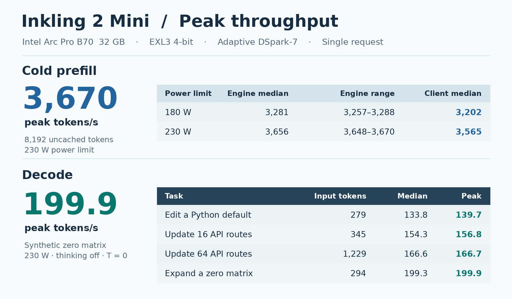

# Inkling 2 Mini auf der B70 bei 180 und 230 W

Gemessen am 23. November 2026 über den produktiven Inkling-Endpunkt im B70 Observatory, nach Cache-Fix d1f1461. Eine Karte, eine Sequenz, EXL3 4 Bit, Vision geladen, adaptives DSpark mit bis zu sieben Vorschlägen, probabilistischem Draft-Sampling und Block-Verifikation, bfloat16, KV-Cache fp8_e4m3, Eager-Modus, max_num_batched_tokens 6.144 und Kontextfenster 262.144. Der 8K-Vergleich lief seriell im echten Pi Coding Agent mit automatischer Compaction. Die Kurzprompt-Messungen nutzten die native Engine-API. Jeder Erstaufruf erhielt ein frisches Cache-Salt. Der Prozess setzte das ursprüngliche Kartenlimit nach jedem Versuchsteil zurück. [Engine-Startparameter, Kernel-Schalter und Image-ID](engine-config.json).

## Prefill bei exakt 8.192 Eingabetoken

Vier verschiedene Aufgaben, jeweils dieselben drei Seeds an beiden Limits. Zeitmessung mit warmem Server. Die zwölf Erstaufrufe je Limit hatten null gecachte Token. Die Arbeitslast umfasst Quelltext, eine Routingtabelle, eine neue Implementierung und einen Editierauftrag. Nachfolgende Tool-Requests und Formaufwärmläufe sind aus der Prefill-Tabelle ausgeschlossen. Die Engine-Rate nutzt den nativen vLLM-Prefill-Timer. Die Client-Rate teilt die Zahl der Eingabetoken durch die Zeit bis zum ersten nichtleeren Stream-Delta inklusive Thinking.

| Powerlimit | Läufe | Engine-Median (Spanne), tok/s | Client-Median, tok/s | Median bis erstes Delta | Client ≥3.500 |
| ---: | ---: | ---: | ---: | ---: | ---: |
| 180 W | 12 | 3.281 (3.257–3.288) | 3.202 | 2,559 s | 0/12 |
| 230 W | 12 | 3.656 (3.648–3.670) | 3.565 | 2,298 s | 12/12 |

## Decode bei produktivem Sampling und 8K Eingabe

Medium Thinking, Budget 8.192, Temperatur 1, top-p 0,95, top-k 20. Die Decode-Rate ist (generierte Token − 1) geteilt durch native Decode-Zeit. Sie umfasst Thinking und Antwort. Beim Datei-Edit ist die Rate über alle Modellaufrufe des jeweiligen Pi-Laufs zeitgewichtet. Dateischreibvorgänge und Toolzeit gehen in die zusätzliche Sitzungsdauer ein.

| Aufgabe | Median 180 / 230 W (tok/s) | Spanne 230 W | Median gesamte Pi-Sitzung 230 W | Korrekt 180 / 230 W |
| --- | ---: | ---: | ---: | ---: |
| Python-Datei mit geändertem Standardwert komplett ausgeben | 119,2 / 130,3 | 125,8–135,4 | 13,6 s | 3/3 · 3/3 |
| 64 Routen von v1 auf v2 migrieren und komplett ausgeben | 130,0 / 142,1 | 138,8–144,0 | 12,1 s | 3/3 · 3/3 |
| Parser und Formatter neu implementieren | 94,9 / 103,0 | 101,6–103,7 | 42,1 s | 3/3 · 3/3 |
| Standardwert in Datei durch Pi-Tools ändern | 105,3 / 118,1 | 102,0–119,8 | 6,5 s | 3/3 · 3/3 |

## Kurze Prompts direkt an die Engine

Diese Messungen nutzten denselben laufenden OpenAI-kompatiblen Chat-Endpunkt direkt mit einer User-Nachricht, frischem Cache-Salt und einer Sequenz. Die API meldete null gecachte Token. Drei Einstellungen wurden zunächst bei 230 W gemessen: Low-Thinking mit Budget 256 und Temperatur 1 (sample), Low mit Temperatur 0 (greedy), sowie deaktiviertes Thinking mit Budget 0 und Temperatur 0 (none). top-p 0,95 und top-k 20. Prompts und Ausgabelängen stammen aus der tatsächlichen API-Usage. Ein Quelltext gilt als korrekt, wenn er dem erwarteten Text oder seinem vollständigen Python-Syntaxbaum entspricht. Der strukturierte Edit wird als exakter Textaustausch geprüft.

| Aufgabe | Eingabe | Modus | Korrekte Läufe 180 / 230 W | Median 180 / 230 W | Höchster korrekter Wert 230 W | Ausgabe bei 230 W |
| --- | ---: | --- | ---: | ---: | ---: | ---: |
| Python-Datei, ein Standardwert | 279 | none | 2 / 6 | 120,6 / 133,8 | 139,7 | 240–240 |
| 16 API-Pfade, v1 → v2 | 345 | none | 2 / 3 | 138,6 / 154,3 | 156,8 | 305–305 |
| Zwei Codevorlagen auf 24 Adapter erweitern | 236 | none | 0 / 5 | — / 154,8 | 155,8 | 1905–1905 |
| Strukturierter Edit-Aufruf | 185 | sample | 2 / 3 | 115,4 / 117,3 | 134,7 | 89–147 |
| 64 API-Pfade | 1229 | none | 2 / 3 | 152,2 / 166,6 | 166,7 | 1173–1173 |
| Jahr im MIT-Lizenzkopf ändern | 293 | none | 2 / 3 | 134,1 / 146,8 | 150,0 | 252–252 |
| Synthetische 16 × 16 Nullmatrix erweitern | 294 | none | 2 / 6 | 181,0 / 199,3 | 199,9 | 834–834 |

Von 73 vollständig protokollierten direkten Anfragen bestanden 63 die Ausgabekontrolle. Ein zusätzlicher 8K-Aufruf ohne sichtbares Antwort-Delta ließ sich zunächst nicht vollständig protokollieren und wurde wiederholt. Die Tabelle enthält die korrekten Antworten in den für Wiederholungen ausgewählten Konfigurationen. Ein Strich bedeutet, dass bei diesem Limit keine korrekte Antwort in dieser Konfiguration vorlag. Bei Temperatur 0 liefern unterschiedliche Seeds gewöhnlich denselben Text und geben eine Wiederholung der Zeitmessung. [Alle direkten Messungen einschließlich Fehlversuchen](direct.jsonl).

Der höchste korrekte Wert war 199,9 tok/s (Synthetische 16 × 16 Nullmatrix erweitern, 294 Eingabetoken, 834 generierte Token). Die Karte zog in diesem Aufruf im Mittel 228,7 W. Der Verifizierer akzeptierte 97,3 % der vorgeschlagenen Token. Einschließlich des regulären Tokens ergaben sich 7,81 Ausgabetoken pro Spekulationsrunde.

## Nur die Promptlänge ändern

Jeweils derselbe Editierauftrag bei 230 W und deaktiviertem Thinking, Temperatur 0, drei Messungen pro Länge. Beim langen Prompt steht zusätzlich ein Auszug aus einem Django-Repository vor der Aufgabe. Die Mediane verwenden ausschließlich korrekte Antworten. Die Vergleichsgröße ist die native Decode-Rate.

| Aufgabe | Eingabetoken kurz / lang | Korrekte Läufe kurz / lang | Median tok/s kurz / lang | Seed-Paare mit identischer korrekter Antwort |
| --- | ---: | ---: | ---: | ---: |
| Python-Datei, ein Standardwert | 279 / 8192 | 3/3 · 0/3 | 129,5 / — | 0 |
| Zwei Codevorlagen auf 24 Adapter erweitern | 236 / 8192 | 3/3 · 0/3 | 154,4 / — | 0 |
| Synthetische 16 × 16 Nullmatrix erweitern | 294 / 8192 | 3/3 · 3/3 | 199,8 / 187,5 | 3 |

Fehlversuche nach Aufgabe, Leistungslimit und Modus: tinyedit (230 W, none) × 1, tinygen (180 W, none) × 2, tinygen (230 W, none) × 1, tinyfile_padded (230 W, none) × 3, tinygen_padded (230 W, none) × 3. Die Decode-Raten im Bericht beruhen auf dem nativen Engine-Timer und korrekt geprüften Ausgaben.

Im gesamten Lauf lag die höchste abgetastete GPU-Pakettemperatur bei 71 °C. Der Xe-Kartenzähler wurde während Prefill und Decode in Abständen von etwa 75 ms gelesen. Die Gesamtwiederholungen im Primärvergleich folgten der Leistungsfolge 180, 230, 230, 180, 180, 230 W. Der dritte Seed wurde wie die anderen beiden bei beiden Limits gemessen.

Die Einzelmessungen einschließlich Prompt-Hash, Cache-Hits, Engine- und Client-Dauer, tatsächlichen Pi-Samplingwerten und Energiezählerwerten liegen in [verified.jsonl](verified.jsonl). Die Quelltext-Umschreibungen werden auf Textgleichheit bis auf den verlangten Austausch und abschließende Zeilenumbrüche geprüft. Beim Datei-Edit wird der Patch unabhängig auf die Ausgangsdatei angewendet. Für den neuen Parser laufen semantische Tests in einem isolierten CPU-Container.

[Aufgaben für die direkten Kurzprompt-Messungen](short-prompts.json) · [Chat-Request für den höchsten Decode-Wert](matrix-request.json). Für einen kalten Lauf bei jeder Anfrage ein neues `cache_salt` setzen.
