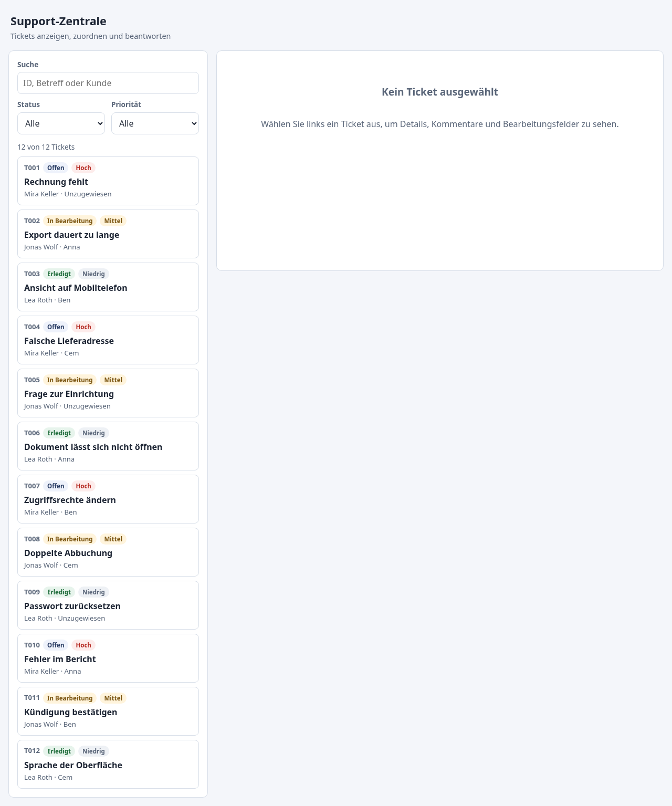
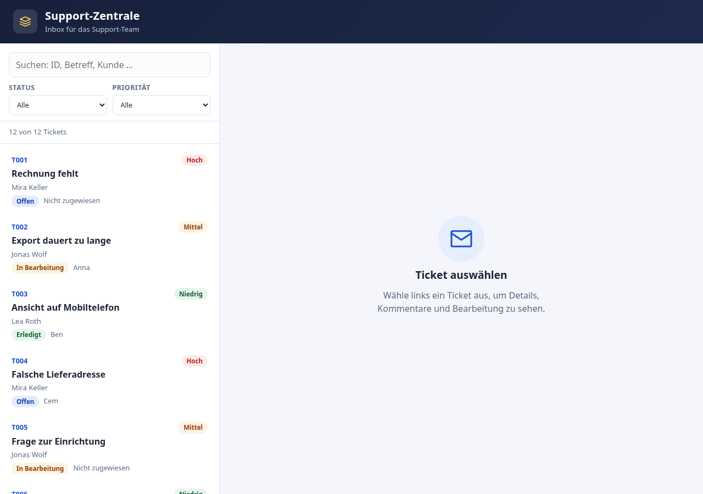
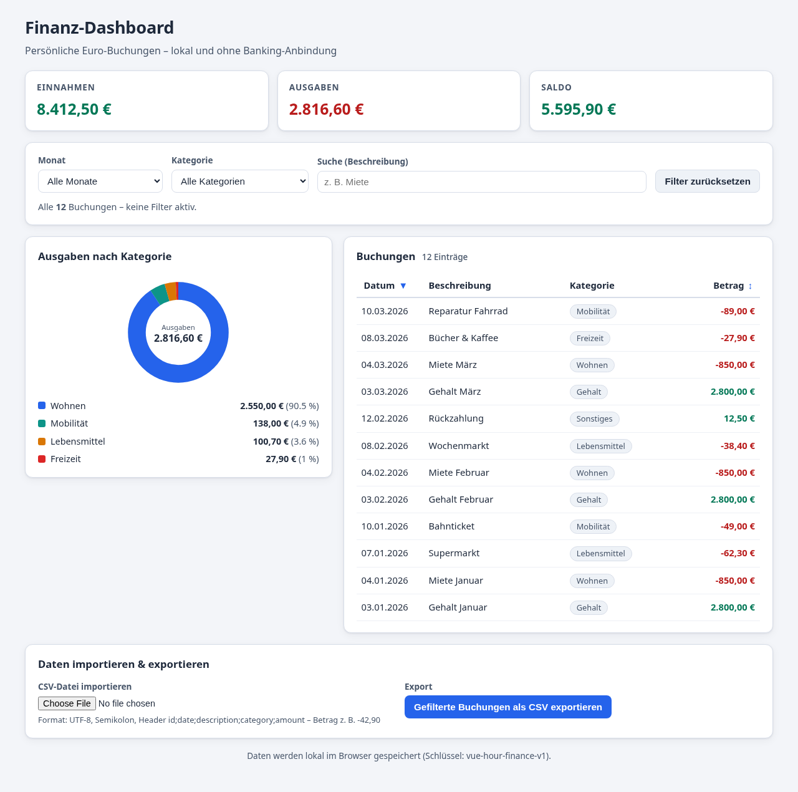
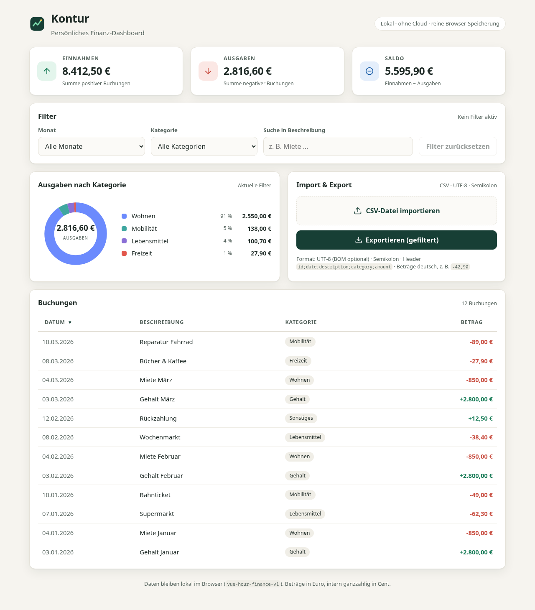
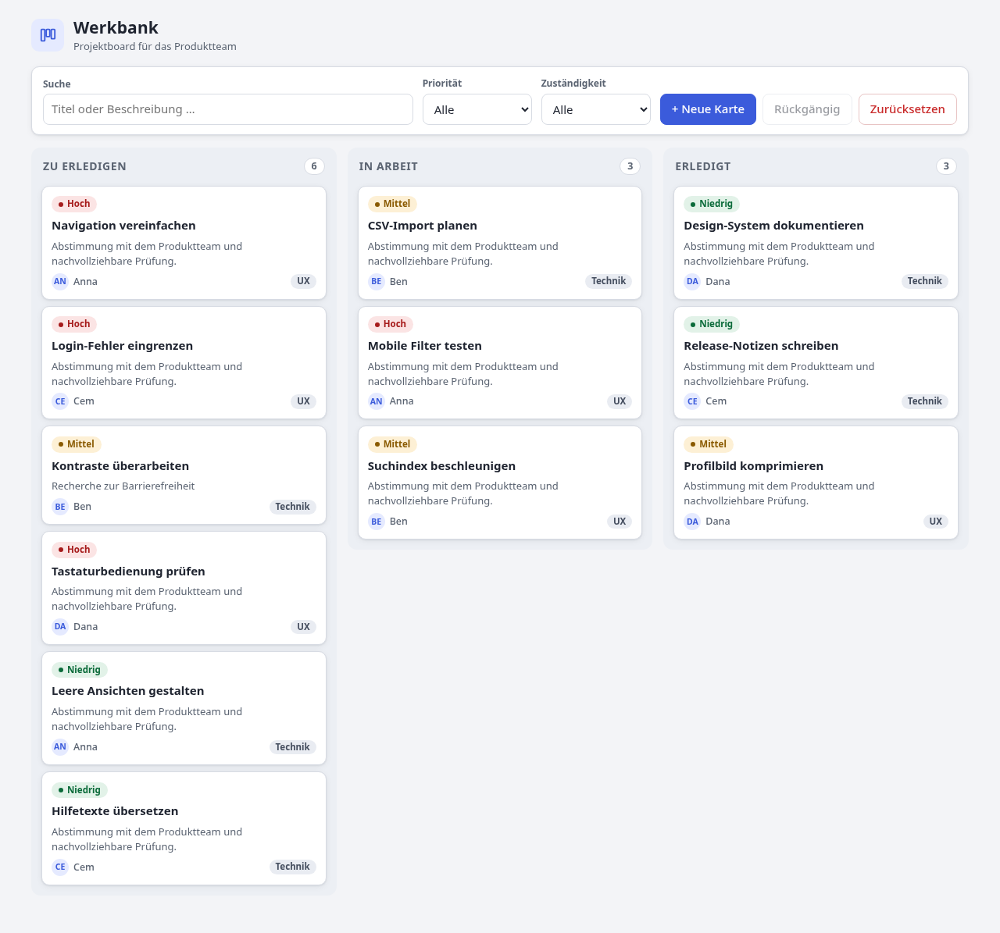
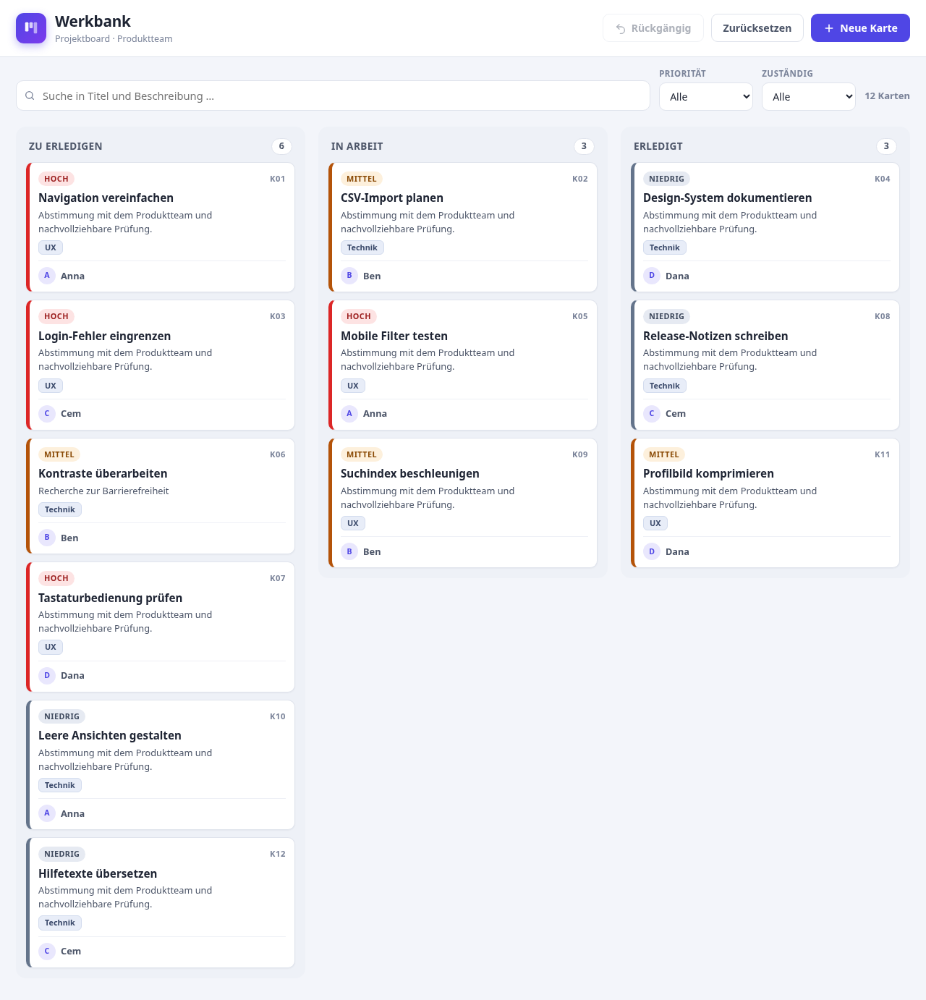

# Drei Vue-Web-Apps mit Inkling und Qwen auf der B70

Drei eingefrorene Vue-/TypeScript-Aufgaben, je eine erste Abgabe mit dem echten Pi Coding Agent und Browserwerkzeugen. Die Qwen3.8-27B-Läufe stammen vom 30. Oktober 2026. Inkling 2 Mini EXL3 lief am 23. November auf derselben B70 mit 180-W-Limit, FP8-KV, Vision und adaptivem DSpark mit bis zu sieben Vorschlägen. Der Zeitpunkt der Fertigmeldung stammt jeweils aus der Pi-Laufdatenbank. Die unabhängige Prüfung fand anschließend statt.

| Aufgabe | Inkling, Tests | Qwen, Tests | Inkling, Zeit | Qwen, Zeit | Inkling-Zeit relativ zu Qwen |
|---|---:|---:|---:|---:|---:|
| Signal · Support | 12/13 | 11/13 | 24:18 | 19:45 | +23,1 % |
| Kontur · Finanzen | 16/16 | 16/16 | 13:09 | 15:07 | -13,0 % |
| Werkbank · Kanban | 15/15 | 15/15 | 16:17 | 20:24 | -20,2 % |
| **Summe** | 43/44 | 42/44 | 53:44 | 55:16 | -2,8 % |

Inkling war bei Finanz-Dashboard und Kanban früher fertig, beim Support später. Beide Modelle erhielten bei zwei von drei Erstabgaben die vollständige externe Abnahme. Über die drei Apps lag die Zeit bis zur Abgabe mit Inkling insgesamt rund 1 Minute 31 Sekunden niedriger (2,8 %).

Beide Modellprofile verwendeten Medium Thinking, ein 8.192-Token-Denkbudget, 262.144 Tokens Kontext, Temperatur 1, Top-p 0,95, Top-k 20 und Seed 42. Inkling lief mit automatischer Compaction und 4.096 zuletzt beibehaltenen Tokens. Jede Abgabe startete mit exakt demselben Git-Baum wie die jeweilige Qwen-Aufgabe. Der Browserprüfer verwendete die eingefrorenen geschützten Dateien, dieselben Testfälle sowie separate TypeScript- und Build-Prüfungen. Keine Nachbesserung nach der ersten Abgabe.

Qwens historischer Support-Prompt nannte neben dem nominellen Stundenbudget einen früheren abendlichen Stopp nach etwa 33½ Minuten. Qwen meldete sich nach knapp 20 Minuten fertig. Die anderen Uhrzeiten und die nötigen modellspezifischen Provider-Einstellungen unterscheiden sich ebenfalls. Beobachtet wurden die fertigen Modell- und Agentenprofile, jeweils mit einem Lauf pro Aufgabe. Die Zeit ist die Dauer der Arbeit bis zur ersten Abgabe einschließlich Modellanfragen, Browser und Werkzeugen.

### Signal · Support

- **Inkling**. Offen blieb „Failed detail load has explicit retry that works“. Die externe Abnahme war unvollständig.

- **Qwen**. Offen blieb „Conflict is explained without silently overwriting server“, „After conflict reload a new edit saves correctly“. Die externe Abnahme war unvollständig.

Im zusätzlichen Browsertest luden beide Apps das zunächst fehlschlagende Detail für T006 über die sichtbare Schaltfläche erfolgreich nach. Beide erklärten einen realen Speicherkonflikt, verhinderten ein Überschreiben und speicherten den neuen Kommentar nach dem erneuten Laden genau einmal. Die Rohwertverluste in diesen Abläufen betrafen die erwarteten Test-IDs für sichtbare Meldungen. Bei T012 blieb der Detailanfang auf Inkling in der Desktopansicht sichtbar (79 px vom oberen Fensterrand). Bei Qwen lag er 522 px oberhalb des sichtbaren Bereichs. Beim Navigieren während des Speicherns blieb Inkling beim ursprünglichen Ticket und zeigte dessen neuen Status. Qwen wechselte das Ticket, zeigte aber für das vorherige Ticket den veralteten Status in der Liste.

| Qwen, Desktop | Inkling, Desktop |
|---|---|
|  |  |

[Qwen mobil](screenshots/support-qwen-mobile.png) · [Inkling mobil](screenshots/support-inkling-mobile.png)

### Kontur · Finanzen

- **Inkling**. Alle eingefrorenen Prüfungen bestanden. Die externe Abnahme war erfolgreich.

- **Qwen**. Alle eingefrorenen Prüfungen bestanden. Die externe Abnahme war erfolgreich.

Bei identischen Beträgen behielt Inkling die ursprüngliche Zeilenreihenfolge auch beim absteigenden Sortieren, während Qwen die Gleichstände umdrehte. Beim simulierten vollen Browserspeicher verloren beide Apps den neuen Import nach dem Neuladen. Inkling zeigte vorher ausdrücklich „Speichern im Browser fehlgeschlagen“ an, Qwen meldete einen erfolgreichen Import. Der ältere automatische Warntext-Filter erkannte Inklings Formulierung nicht. Das sichtbare Seitentext-Protokoll enthält die Meldung. Bei einem separat getesteten teilweise beschädigten Bestand warnte Inkling und fiel auf die Startdaten zurück, wodurch auch der gültige Eintrag verloren ging. Qwen behielt den gültigen Eintrag, übernahm aber auch das unmögliche Datum 30. Februar. Beide ließen den fremden Speicherschlüssel intakt.

Der erste Desktop-Screenshot zeigt bei Inkling Diagramm, Legende und CSV-Import nebeneinander. Qwen gibt der Buchungstabelle in der ersten Bildschirmansicht mehr Platz. Die mobilen Screenshots zeigen von beiden Apps die Hinweise auf beschädigte Daten oberhalb der Kennzahlen.

| Qwen, Desktop | Inkling, Desktop |
|---|---|
|  |  |

[Qwen mobil](screenshots/finance-qwen-mobile.png) · [Inkling mobil](screenshots/finance-inkling-mobile.png)

### Werkbank · Kanban

- **Inkling**. Alle eingefrorenen Prüfungen bestanden. Die externe Abnahme war erfolgreich.

- **Qwen**. Alle eingefrorenen Prüfungen bestanden. Die externe Abnahme war erfolgreich.

Beide Boards bestanden die zusätzliche Prüfung mit echter Mausbewegung sowohl auf einem frischen Board als auch nach Rückgängig und Neuladen. Bei Inkling hat der Karteneditor ein bearbeitbares Feld für Tags. Bei Qwen fehlt es. Qwen hält dagegen den Tastaturfokus im geöffneten Dialog. Bei Inkling erreichte Tab unter anderem die Suche und die Schaltfläche für eine neue Karte hinter dem Dialog.

Auf dem Desktop stellt Inkling die Priorität zusätzlich durch eine farbige Kartenkante dar. Qwens kompaktere Karten lassen mehr Einträge gleichzeitig überblicken. Beide zeigen auf dem Mobiltelefon die Spalten untereinander.

| Qwen, Desktop | Inkling, Desktop |
|---|---|
|  |  |

[Qwen mobil](screenshots/kanban-qwen-mobile.png) · [Inkling mobil](screenshots/kanban-inkling-mobile.png)

## Was Pi während der Arbeit gemessen hat

Die beiden Zahlen pro Feld stehen für Qwen / Inkling. Die letzten vier Spalten stammen aus den Inkling-Serverzählern über die gesamte Sitzung. Ein Bild-Turn ist eine Anfrage, deren Verlauf mindestens ein Bild enthält. Die Screenshot-Spalte vergleicht verschiedene archivierte Qwen-Bilder mit verschiedenen, über den Übertragungs-Hash bestätigten Inkling-Bildern. Ausgabetokens schließen Denken und Toolaufrufe ein. Modelle haben unterschiedliche Tokenizer.

| Aufgabe | Modellantworten Q / I | Ausgabetokens Q / I | Screenshots Q / I | Inkling Prefill | Inkling Decode | Bild-Turns mit 0 gecachten Texttokens | Akzeptierte Draft-Tokens je Runde |
|---|---:|---:|---:|---:|---:|---:|---:|
| Signal · Support | 78 / 114 | 38.217 / 39.023 | 49 / 54 | 15:47 | 7:41 | 57/94 | 2,1 |
| Kontur · Finanzen | 47 / 47 | 38.259 / 48.465 | 15 / 11 | 3:37 | 9:14 | 11/20 | 2,1 |
| Werkbank · Kanban | 76 / 68 | 46.881 / 40.315 | 25 / 28 | 8:12 | 7:36 | 28/38 | 2,2 |

[Messwerte, Einzelprüfungen und Startrevisionen](first-submissions.json)

Wenn sich die Liste der übertragenen Screenshot-Hashes gegenüber der vorangegangenen Anfrage änderte, meldeten **96 von 102** Anfragen null gecachte Texttokens. Bei unveränderter Bildliste waren es **0 von 50**. Das ist eine Korrelation innerhalb dieser Pi-Sitzungen. Ein gezielter Replay mit denselben Nachrichten und Bildern könnte den Anteil von Pi-Bildauswahl und Engine-Cache trennen.

[Zusätzliche Browserabläufe auf den unveränderten Abgaben](browser-diagnostics.json)
