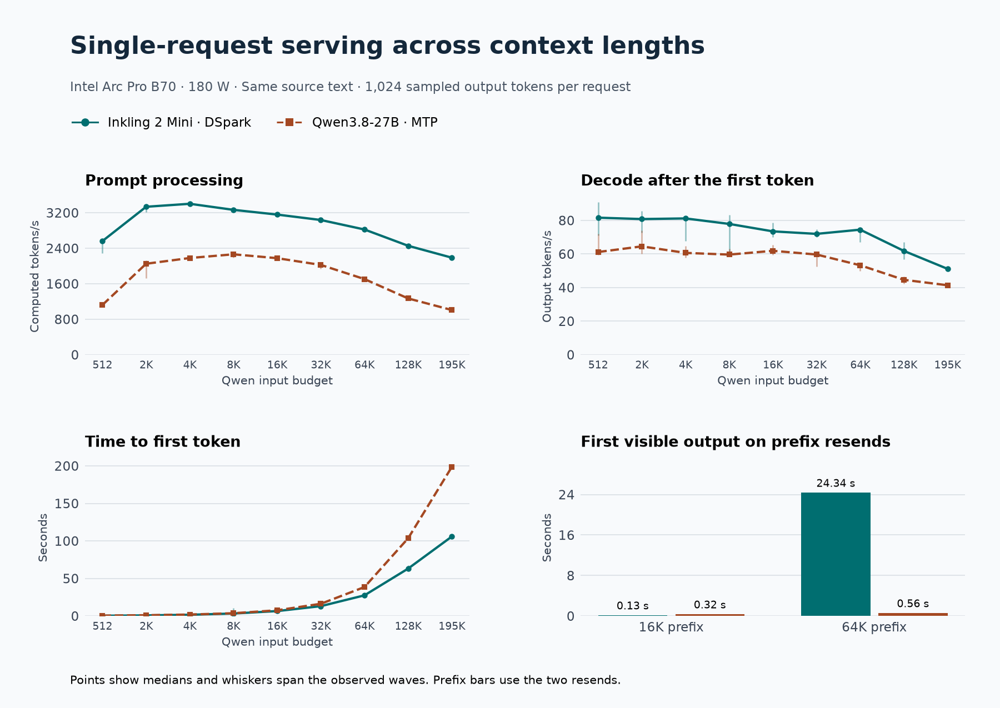
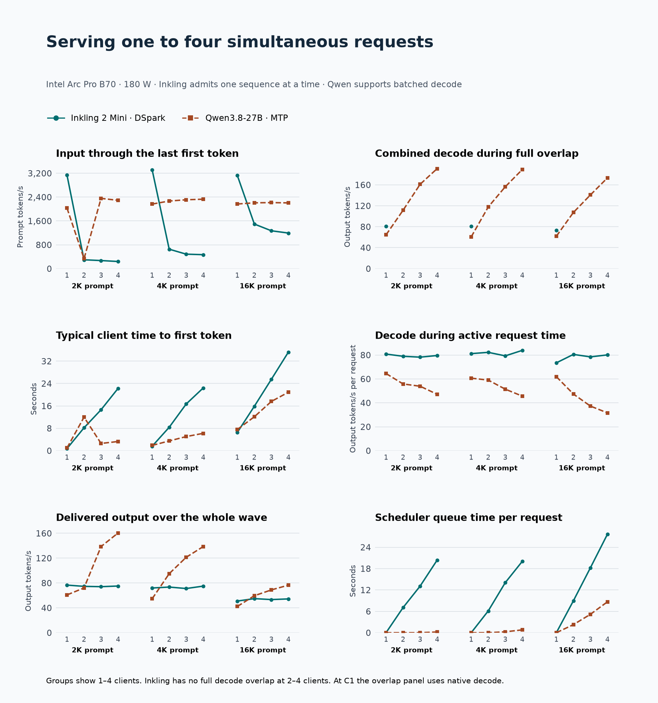

# Inkling and Qwen serving on one Arc Pro B70

The November 23 Inkling run replays the November 14 Qwen EXL3 R12 release workload at 180 W. Clients submit identical source-review text from the original archive. Each client requests 1,024 sampled output tokens. Both releases use temperature 1, top-p 0.95, top-k 20, the same per-request seeds and forced length. Inkling uses adaptive DSpark with up to seven proposals, an FP8 KV cache, 6,144-token prefill chunks and vision enabled. The benchmark sends text. Qwen uses MTP with three proposals.

## Reading the figures





[All 20 scenarios, individual prefix passes, timings and energy](measurements.md) · [Paired per-wave data and Inkling runtime configuration](waves.json)

The context labels are the Qwen input budgets. Inkling's tokenizer assigns different token counts to the same text. The one-client table gives both actual counts. These comparisons cover generated throughput and latency. The separate Pi repair benchmarks evaluate coding quality.

- Native prefill divides newly computed input tokens by server prefill seconds. Native decode divides post-first output tokens by summed server decode seconds. Individual requests contribute time only while active.
- End-to-end throughput divides all output tokens by elapsed wave time, from simultaneous submission to the final reply. The full-matrix result divides total output by summed wave time. It excludes warmups, the isolated control and time spent preparing fixtures between waves.
- The combined prefill figure divides logical input tokens by the time until every client has received its first token. With Inkling's single slot, later clients can wait through earlier clients' entire responses. The queue-time panel uses the server's accumulated scheduler wait divided by the number of clients.
- Fully overlapping decode uses sampled generation counters in the interval after the last first token and before the earliest completion. At C1 the figure shows native decode. The per-request curve uses native decode time. First-token latency includes waiting and uses the median of the client latencies in each wave.
- Each point shows the median across its measured waves. The context whiskers give the observed range. Prefix bars use the median of the two resends. Whole-card energy comes from the GPU hwmon card energy counter.
- Inkling's benchmark requests set both `reasoning_effort="none"` and `thinking_token_budget=0`. The report checks that every completion reached its budget with visible content and zero reasoning tokens. The production Pi profile uses medium thinking and an 8,192-token budget.

The Qwen curves use the original November 14 matrix throughout. Its 2K two-client waves had unusually long stalls. A six-wave repeat the next day gave different latencies. Keeping the dated runs separate preserves the measured whole-matrix total. [Qwen follow-up measurements](https://github.com/Danmoreng/intel-b70-qwen38-vllm/blob/0356a370da5f73f6b0a4eab613d7103a2356b513/benchmarks/results/direct-xpu-followup-20261115/README.md)

The current recipe fixes the 64K prefix behavior measured below. [Post-fix measurements and reproduction](../prefix-cache/README.md)

## What happened on the 64K prefix

The three matrix requests contain the same 74,690 Inkling input tokens. The second request reused 74,688 tokens and spent 0.032 s in native prefill. Its stream sent an initial role event at 0.116 s, then delivered its visible content together at 21.62 s. The third request recorded zero cached tokens and took 27.07 s to first visible output. The isolated restart reproduced the same cache sequence of 0, 74,688 and 0 reused tokens. Its two resends took 18.31 s and 27.16 s to first visible output. Both 16K resends in the matrix returned visible text in 0.13 s. A fast native cache hit and a fast visible response are separate observations.

The single-slot history guard provides a possible explanation for the third request's cache miss. It resets the saved snapshot when ownership changes and records a new one for a scheduled chunk larger than eight tokens. After the first 64K cache hit only two prompt tokens remained, versus eleven in the 16K case. The benchmark recorded cache counters and stream events. Establishing the cause of the late content event would require tracing the output path. [Ring history guard](../../../inkling_xpu/ring_prefix.py)

## Why concurrent clients queue

The Inkling adapter allocates one external sequence slot for local attention history, checks for one sequence in the attention metadata and uses the first request's page table during prefill. DSpark takes one request's sampling seed, last sampled token, sequence length and rejection count. Its seven proposal positions belong to that sequence. Both components explicitly require `max_num_seqs=1`. Qwen's serving adapter supports multiple active sequences on the same card. [Target adapter](../../../inkling_xpu/vllm_model.py) · [DSpark adapter](../../../inkling_xpu/dspark.py)

## Reproduce the qualification

Use the [Qwen release harness at 0356a37](https://github.com/Danmoreng/intel-b70-qwen38-vllm/tree/0356a370da5f73f6b0a4eab613d7103a2356b513) and its local R12 raw serving archive, including the `warmups/` directory. The raw prompts are archived outside Git. The adapter verifies the inventory of 248 measured input files and 70 warmup input files and pins the streaming client, metric sampler and scenario definitions by SHA-256. It retains the original text, sampling, cache identifiers where present and seeds. It translates the model selection and thinking controls for Inkling.

Start a fresh idle Inkling worker with the benchmarked recipe and exclusive access to the B70. The runner verifies the 180 W power cap, endpoint identity, draft ceiling, single sequence, context limit and empty completion counters. On the reference host, use the Observatory service controls to restart the selected Inkling engine. Set an outer timeout that leaves time for cleanup before the host's daily shutdown.

```bash
QWEN=/path/to/intel-b70-qwen38-vllm
REFERENCE="$QWEN/benchmark-results/direct-xpu-20261114/release-m04fix-r12/serving/run-20261114-214533-w0.05"
OUT=results/serving-new
mkdir -p "$OUT"
python3 scripts/bench-serving-matrix.py --reference-repo "$QWEN" \
  --reference-run "$REFERENCE" --output "$OUT/full"
# Restart the idle Inkling engine to obtain an empty prefix cache.
python3 scripts/bench-serving-matrix.py --reference-repo "$QWEN" \
  --reference-run "$REFERENCE" --output "$OUT/isolated" --isolated-prefix
uv run --with matplotlib==3.11.2 python scripts/report-serving-matrix.py \
  --inkling-run "$OUT/full" --reference-run "$REFERENCE" --isolated-run "$OUT/isolated" \
  --output "$OUT/report"
```

The raw directories hold request settings, prompt bytes, streamed event timings, output text, before/after Prometheus counters, scheduler samples, per-wave summaries and the worker configuration. To redraw the published results from the included data, run the following from the Inkling repository root.

```bash
uv run --with matplotlib==3.11.2 python scripts/report-serving-matrix.py \
  --output benchmarks/2026-11-23/serving
```
